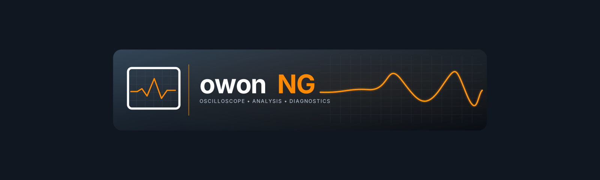
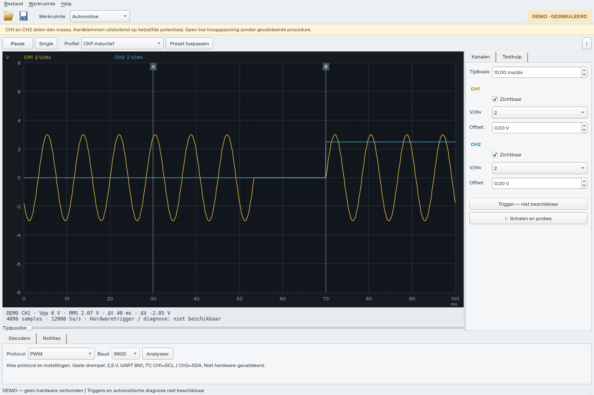
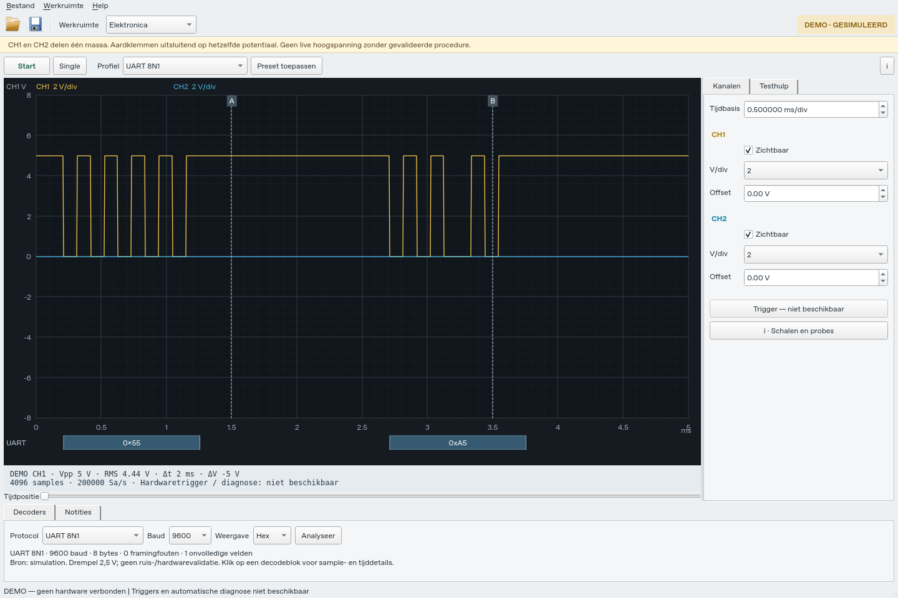
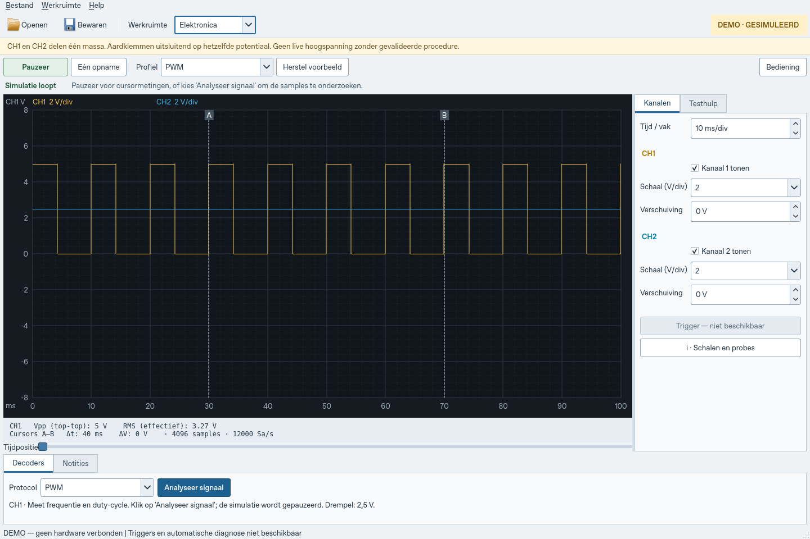
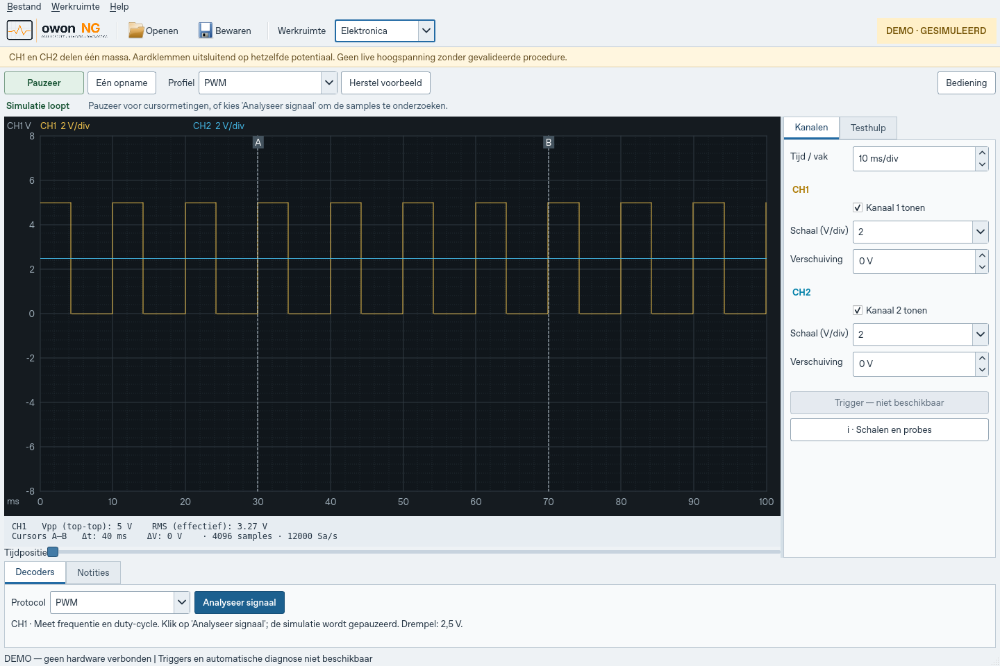

# Owon NG — native oscilloscoopapp

Versie 0.4.3 is een native Python/Qt-app met een QPainter-golfvormcanvas. De oude browserlaunchers en WebView-verpakking zijn verwijderd. De HTML/TypeScript-prototypes blijven uitsluitend als ontwerpreferentie aanwezig.

Start:

    python -m pip install -r requirements-native.txt
    python app.py

De workflow **Native app packages** bouwt op Windows een ZIP met Owon_NG-0.4.3.exe en de vereiste Qt/Python-bibliotheken. Pak de hele ZIP uit. De Python-brondistributie heet Owon_NG-0.4.3-python-native.zip.

Werkend: twee kanalen met zichtbaarheid, V/div en offset; tijdbasis en verschuiven; sleepbare en met toetsenbord bedienbare cursors met Δt/ΔV; start/pauze/single; Vpp/RMS van synthetische samples; CKP/lambda/injector/CAN/PWM/sinus-fixtures; hulp met technische details; begeleide instructies; notities; native bestandsdialogen met JSON bewaren/openen; bibliotheek, opnamegeschiedenis en demo-rapportweergave.

Alle signalen zijn expliciet DEMO of geïmporteerde demo-opnames. USB-aansturing, echte triggers, extra protocoldecoders, gevalideerde referentiegolfvormen en diagnostische algoritmen zijn nog niet geïmplementeerd. De rapportweergave is nog geen rapportexport. Een native Android-app is nog niet gebouwd; de oude WebView-APK is niet de gewenste app.

Veiligheid: de VDS1022I-ingangskanalen delen een gemeenschappelijke massa. Sluit aardklemmen nooit op verschillende potentialen aan. Live hoogspanning vereist passende probes en een gevalideerde procedure.

Zie docs/NATIVE_APP.md voor bouwen/licenties en docs/UI_SPEC.md voor de oorspronkelijke producteisen.

Controle:

    python -m unittest discover -s tests -p test_native.py -v

Qt/PySide6 wordt onder LGPLv3 gebruikt. De projectlicentie is nog niet gekozen. Zie docs/THIRD_PARTY.md.

## 0.3.1 — twee werkgebieden en analyse

Automotive: begeleide component- en passieve actuatortests, waaronder PWM-solenoïde.
Elektronica: eerste offline UART 8N1, I²C byte/ACK en PWM duty/frequentie op de aanwezige samples. SPI/CAN-protocol zijn nog gepland. Zie docs/NATIVE_APP.md voor instellingen en beperkingen. Bronlabels en demonstratiebeperkingen blijven zichtbaar; deze analyse is niet op hardware of ruissignalen gevalideerd.

## Native UI 0.3.2

Instrumentindeling geïnspireerd op de bediening van OpenHantek en de native toolorganisatie van PulseView, onafhankelijk geïmplementeerd.

## Meetkern 0.4.0

Samples zijn onveranderlijk en worden buiten de UI-thread gegenereerd. Schema-2-opnames bewaren samples, timing, kanaalmetadata en weergave-instellingen met integriteitscontrole en atomair opslaan. Oude demo-opnames blijven leesbaar. Uitzoomen behoudt sampled pieken via min/max-enveloppen. Zie [meetkern](docs/ACQUISITION_CORE.md) en [open toestelcontroles](docs/HARDWARE_VALIDATION.md).

Corechecks: python -m unittest discover -s tests -p test_core.py -v.

## Decoderbanen 0.4.1

UART-, I²C- en PWM-blokken staan op dezelfde tijdas als de samples. Analyse bevriest de huidige simulatie; oude resultaten worden niet boven nieuwe frames getekend. Klik een blok voor sample-/tijddetails. Kies Hex/Dec/ASCII/Bin voor de waardeweergave. De algoritmes zijn nog niet gevalideerd op hardware/ruis.

## Leesbaarheid 0.4.2

Een beheerd licht bedieningsthema voorkomt donkere tekst op donkere Windows-invoervelden. Duidelijke status en actieknoppen, contextafhankelijke decoderinstellingen en visuele regressiecontroles. Zie [screenshotcontrole](docs/VISUAL_QA.md).

## Branding 0.4.3

De aangeleverde Flow-kit is geïntegreerd in app-/Windows-icoon, werkbalk, opstartbeeld en Over-dialoog. De volledige kit staat in assets/branding/flow-v2. Zie [branding](docs/BRANDING.md).

